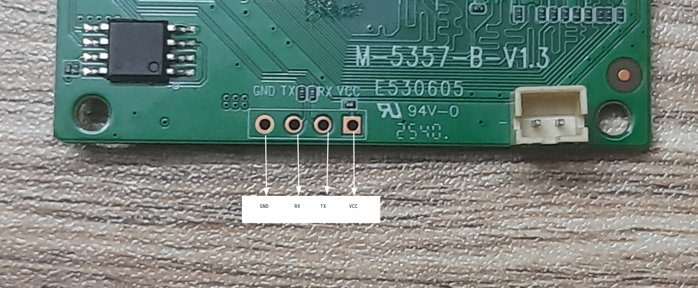
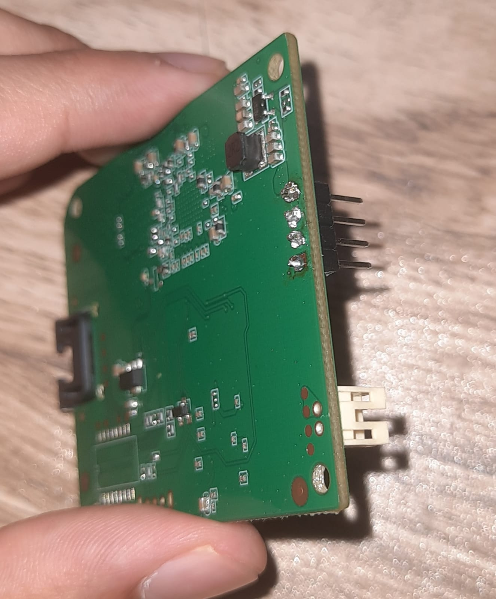

## Device Summary Table
| Item | Detail | Notes | Datasheet |
|------|--------|-------|-----------|
| WiFi Extender | Trenzu WiFi Extender | Board: M-5357-B-V1.3 | N/A |
| SoC | Broadcom BCM5357 | MIPS, 32-bit little-endian, 300 MHz | N/A |
| Flash | GigaDevice GD25Q64 | 64 Mbit (8 MB) SPI NOR | [GD25Q64C](https://www.tme.eu/Document/adfc3a1a269cb52cdae9532d711c82d9/gd25q64c.pdf) |
| RAM | Samsung K4H511638G | 512 Mbit (64 MB) DDR SDRAM | [K4H511638G](https://www.alldatasheet.com/html-pdf/351801/SAMSUNG/K4H511638G/297/1/K4H511638G.html) |

# UART Access: Pin Identification and Confirmation 

## Summary
Silkscreen labels on the UART do not match behavior (from multimeter observations). The pin labelled "RX" (on device) outputs the boot log (device TX). The pin labelled (on device) "TX" produced no output and its read function could not be confirmed. Console appears to be output only.

## Equipment
- Multimeter
- USB-UART adapter
- Picocom (software used to see the device output)
- Baud rate - 115200
- Reference ground i.e. The metal on the power ON/OFF switch.
- I had so solder header pins on the UART pins to get a stable connection

## 1. Multimeter Observations
| Device Label | Device state | Mode | Output |
|---|---|---|---|
| GND | Off | Continuity | continuous beep sound |
| "TX" | Just turned ON | volt meter | Fluctuates |
| "RX" | Booting | volt meter | Slight fluctuation in beginning |
| "VCC" | Power ON | volt meter | 3.31 V |

**Initial interpretation:**
- The pin labelled as GND is the actual GND
- The pin labelled as "VCC" is the actual VCC
- The pin labelled as "RX" might be the actual RX or TX
- The pin labelled as "TX" might be the actual RX or TX

## 2. Initial Tests
| Wiring (+ GND) | Result |
|---|---|
| adapter TX→device "TX", adapter RX→device "RX", | Boot log |
| adapter TX→device "RX", adapter RX→device "TX" | No output |

## 3. The contradiction
The multimeter suggested "TX" was the active output, but the boot log appeared on the pin labelled "RX" on the device. 
The hypothesis I came up with is that the adapter labels (labelled on the device) might be flipped. 
One more reason I came up with after asking AI was the fluctuation on the device's "TX" pin might be floating-pin noise. 

## 4. Final Tests
| Test | Wiring (+ GND) | Action | Result | Conclusion |
|---|---|---|---|---|
| 1 | adapter RX → Device "RX" | Just after power ON | Log | "RX" pin = device TX |
| 2 | adapter RX → Device "TX" | Just after power ON | No log | "TX" pin is not an output |
| 3 | Test1 + adapter TX → device "TX" | Pressing ctrl+c during boot | Log not interrupted | The UART might not accept input or "TX" might not be the RX |

## 5. Final pinout
| Silkscreen(as labelled) | Real function | Proof |
|---|---|---|
| GND | GND | Continuity |
| "RX" | Device TX | Test 1 (i.e. readable log) |
| "TX" | Probably device RX | Test 2 negative, Test 3 no response |
| "VCC" | VCC | 3.31 V |
