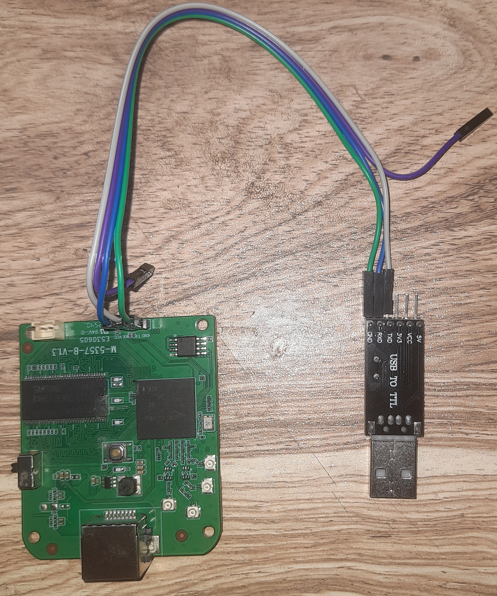
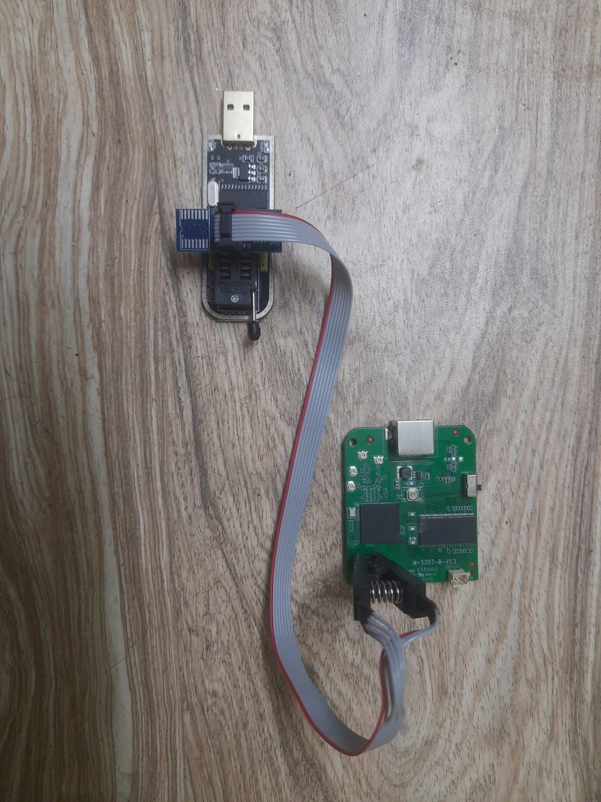

# 02 - Firmware Extraction

## Summary
How I tried to get the firmware off a generic Wi-Fi extender, first through UART and then by dumping the SPI flash chip directly.


## Equipment and Software

**Hardware**
- USB-to-serial (UART) adapter: [3.3V and 5V]
- CH341A SPI programmer with SOIC-8 clip
- Raspberry Pi Pico W (running pico-serprog)

**Software**
- OS: fedora
- picocom: v2024-07
- flashrom: v1.6.0


## Part 1: UART

**Goal:** Get a root console on the device.

### Wiring
The UART pads were connected to the USB-to-serial adapter following the pinout documented in [01 Teardown](/01%20Teardown/uart_analysis.md).

| Adapter | Device |
|---------|--------|
| GND | GND |
| RX | 'RX' |
| TX | 'TX' |



### Command
```bash
sudo picocom -b 115200 /dev/ttyUSB1
```
Settings: 115200 baud. 
Serial device: `/dev/ttyUSB1`.

### Result

After powering on the device, a boot log appeared in the terminal. The full log is saved in [uart_boot_log.txt](uart_boot_log.txt).

### Observations

- No root console or login prompt appeared after the boot log.
- The boot log ends after starting a program at 0x80001000.
- Pressing `Ctrl+c` during boot did nothing. This may mean the UART interface is receive-only from my side (the device's RX is not responding), as noted in [01 teardown](/01%20Teardown/uart_analysis.md).

### What went wrong

- **Problem:** UART gave output only, with no way to interact.
- **Likely cause:** Input from the adapter is not reaching the device, or console input is disabled in the firmware.


## Part 2: SPI Flash Dump
Full details, wiring, and logs: spi-dump.md

**Goal:** Read the full 8 MB contents of the flash chip.

### Wiring
CH341A with SOIC-8 clip, connected in-circuit



### Command
To identify the flash chip:
```bash
sudo flashrom -p ch341a_spi -V
```
To dump the firmware:
```bash
sudo flashrom -p ch341a_spi -r dump1.bin --progress
```

### Result
- A CH341A with a clip never identified the chip. IDs varied between runs, and the board powered up from the programmer.
- Raspberry Pico at 3.3 V gave the same failure, which ruled out the 5 V data lines as the main cause.

### Observations
The device powers on when connected to either the CH341A or the Pico. A multimeter continuity test showed that the flash chip's VCC pin is connected to the same 3.3 V rail as the UART "VCC" pad. This means that powering the chip from the programmer also powers the rest of the board.

### What went wrong
The rest of the board is active while reading in-circuit. The other component like CPU send clock, chip-select, and data lines at the same time as the programmer. 
- **Next step:** Read the firmware directly from the flash chip by removing it from the circuit board.
