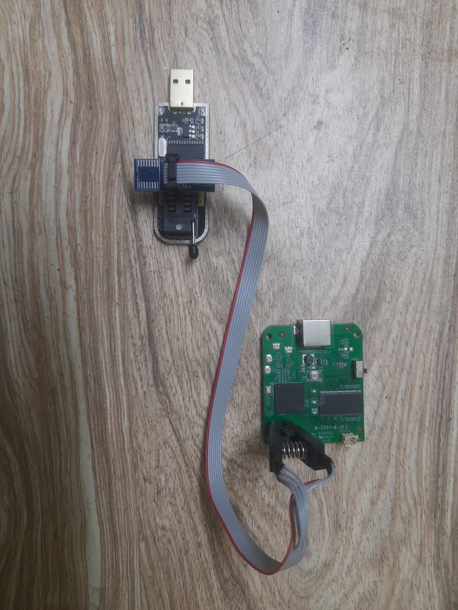
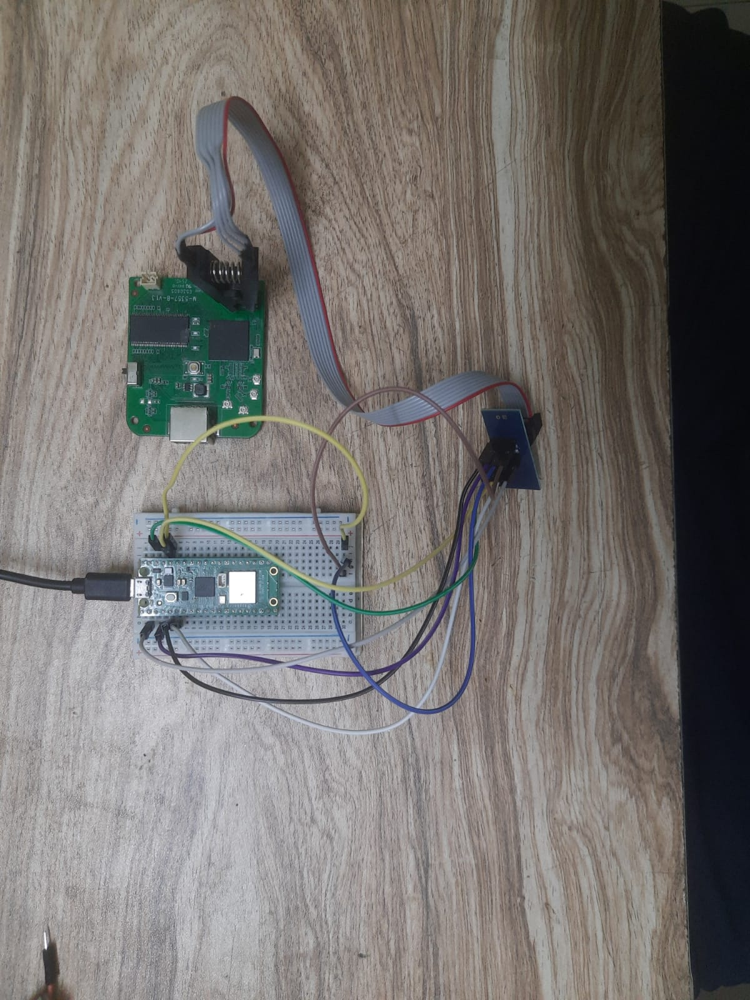

# SPI Flash Dump

## Summary
Attempts to read the firmware straight off the GD25Q64 SPI flash chip, first with a CH341A and then with a Raspberry Pi Pico running pico-serprog.


## Goal
Read the full 8 MB contents of the flash chip and verify the copy by reading it twice and comparing SHA-256 hashes.

## Target Chip
| Item | Value |
|------|-------|
| Chip | GigaDevice GD25Q64 |
| Size | 64 Mbit (8 MB) SPI NOR |
| Supply voltage | 3.3 V |


## Summary of Attempts
| No. | Programmer | Method | Result |
|---|------------|--------|--------|
| 1 | CH341A + SOIC-8 clip | In-circuit read at 5 V data lines | Chip never identified |
| 2 | Raspberry Pi Pico W (pico-serprog) | Wired directly to the chip, 3.3 V logic | Chip never identified |

**Conclusion so far:** The 5 V data lines were not the only problem. The most likely problem is that the rest of the board powers up and stays active while I try to read the chip in-circuit.


## Attempt 1: CH341A with Clip

### Setup
- Programmer: CH341A with SOIC-8 clip, connected in-circuit
- Software: flashrom 1.6.0 on Fedora Linux

```bash

sudo flashrom -p ch341a_spi -V
sudo flashrom -p ch341a_spi -r dump1.bin --progress

```

### What I Tested and Observed

| Test | Result | Conclusion |
|------|--------|-----------------|
| `lsusb` | `1a86:5512` found | The PC sees the programmer correctly |
| Continuity, all 8 pins after connecting the wires to the programmer and device | Beeps on every pin | Physical contact on every clip pin |
| Clip attached, device switch on | Board fully powered up | The programmer was back-powering the board |
| Repeated `-V` probes (5+ runs) | Mostly `0xff 0xffff`, sometimes random values (`0xa4`, `0x48`, `0x90`), once "unknown SPI chip, 0 kB" | Expected `C8 40 17` never appeared. The ID changes between runs, which suggests noise or bus contention rather than one fixed wiring mistake |
| `-r dump1.bin --progress` | "No EEPROM/flash device found" | flashrom needs a successful probe before it will read |
| MISO jumpered to GND | `0x00` | The programmer's MISO input reads low correctly i.e. 0Volts|
| MISO jumpered to VCC | `0xff` | The programmer's MISO input reads high correctly 4.97Volts|
| CLK, CS, MOSI and HOLD voltage | 4.96 V | The CH341A data lines are about 5 V, i.e. hich is above the chip's 3.3 V supply |



### Conclusion
- The programmer itself works.
- Contact on all pins was fine, so a bad clip connection is unlikely.
- The ID changes from run to run, which points to noise on the bus. Something else on the board may be driving the same lines.
- The board powering up while the clip was attached supports the above point.
- The measured 5 V on the data lines raised a second concern, which led to Attempt 2.


## Attempt 2: Raspberry Pi Pico W with pico-serprog

### Why
I thought the 5 V data lines might be corrupting communication with a 3.3 V chip. The Pico's pins run at 3.3 V, so using it as the programmer removes that variable.

### How it works
[pico-serprog](https://github.com/stacksmashing/pico-serprog) by stacksmashing turns a Pico into a SPI programmer that flashrom controls over USB serial, using flashrom's `serprog` programmer type.

### Building the firmware
I built the firmware myself as i could not find the prebuilt file.

```bash
sudo dnf install cmake gcc-arm-linux-gnu arm-none-eabi-gcc \
  arm-none-eabi-newlib git python3 arm-none-eabi-gcc-cs \
  arm-none-eabi-gcc-cs-c++

cd ~
git clone -b master https://github.com/raspberrypi/pico-sdk.git
cd pico-sdk
git submodule update --init
cd ..
export PICO_SDK_PATH=~/pico-sdk

git clone https://github.com/stacksmashing/pico-serprog.git
cd pico-serprog
mkdir build
cd build
cmake ..
make
```

To flash it: hold the BOOTSEL button while plugging in the Pico, then copy the generated `.uf2` file onto the drive that appears.

### Wiring

| Flash pin | Function | Pico connection |
|-----------|----------|-----------------|
| 1 | CS# | GP1 (physical pin 2) |
| 2 | SO (MISO) | GP4 (physical pin 6) |
| 3 | WP# | Tied to VCC |
| 4 | GND | Any Pico GND pin (e.g., physical pin 3) |
| 5 | SI (MOSI) | GP3 (physical pin 5) |
| 6 | SCLK | GP2 (physical pin 4) |
| 7 | HOLD# | Tied to VCC |
| 8 | VCC | Pico 3V3 OUT (physical pin 36) |

**Why WP# and HOLD# are tied to VCC:** Both are active-low control pins. If HOLD# floats or goes low, the chip can pause and stop responding in the middle of a transfer. If WP# floats or goes low, the chip can refuse writes not needed but AI recommended it. Tying both to VCC keeps them inactive.




### Command and Output

```bash
sudo flashrom -p serprog:dev=/dev/ttyACM0:115200 -c "GD25Q64(B)" -V
```

Output:

```text
flashrom v1.6.0 on Linux (x86_64)
Initializing serprog programmer
serprog: connected - attempting to synchronize
serprog: Synchronized
serprog: Interface version ok.
serprog: Bus support: parallel=off, LPC=off, FWH=off, SPI=on
serprog: Programmer name is "pico-serprog"
Probing for GigaDevice GD25Q64(B), 8192 kB: RDID byte 0 parity violation.
compare_id: id1 0xe1, id2 0xffff
No EEPROM/flash device found.
```

I got this same result many times.

### Result
- The Pico connected and flashrom talked to it correctly, so the programmer side works.
- The chip still returned an invalid ID, even with 3.3 V logic. So the 5 V levels from the CH341A were not the main cause.


## Conclusion

| Hypothesis | Evidence | Status |
|------------|----------|--------|
| 5 V data lines break communication | Same failure with a 3.3 V Pico | Ruled out as the main cause |
| Bad clip contact | Continuity on all pins | Unlikely |
| Wrong programmer or software | `lsusb` ok, MISO tests ok, flashrom connects to serprog | Unlikely |
| Rest of the board powers up and interferes with the bus | Board powered on with the clip attached, IDs vary between runs | Most likely, not yet confirmed |

## What Went Wrong and What I Learned
- I first assumed the 5 V logic level was the root cause, then tested that assumption with a second programmer and ruled it out.
- Reading a flash chip in-circuit does not work well when the programmer also powers the rest of the board.
- Several of my tests (like the loopback) were not needed.

## Next Step
Remove the flash chip from the board and read it out of circuit, then repeat the read twice and compare hashes.
